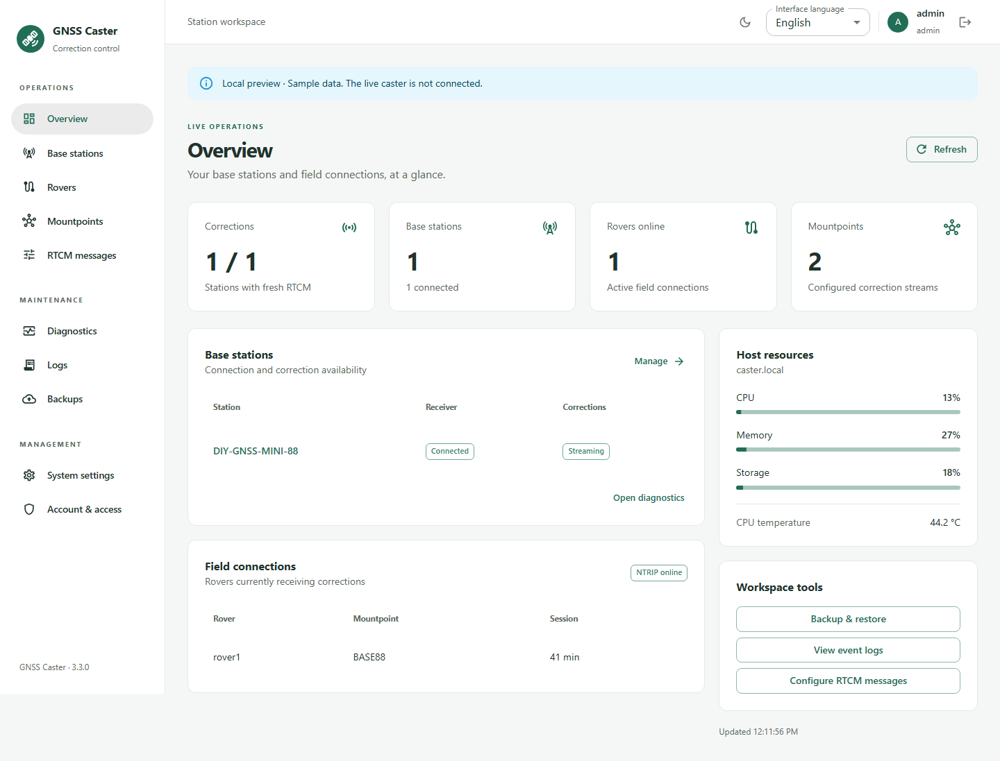

# GNSS Caster

NTRIP caster and receiver management for Raspberry Pi and Linux, with an English/Russian React + Material UI web cabinet.

**Current version: 3.3.0.** Deployment on the reference Raspberry Pi and validation with a live receiver remain pending. See the [product review](PRODUCT_REVIEW.md) and [3.3.0 validation](validation/audit/REPORT.md).



## Features

- RTCM3 corrections over NTRIP, mountpoints, rover credentials and connection limits.
- Bluetooth/BLE and serial receiver configuration, status, console and command history.
- Base coordinates, site points, receiver configuration versions and RTCM presets.
- Separate overview, diagnostics and event-log pages.
- Backup creation, file upload, verification, download and explicitly confirmed restore, including encrypted archives.
- Accounts, roles, two-factor authentication and API tokens.
- English/Russian interface, Telegram bot with its own language setting, light/dark themes and a responsive layout.
- A standalone installer with pinned Python dependencies, systemd/nginx configuration and rollback support for maintenance operations.
- Administrator-confirmed stable GitHub release updates from the web cabinet, with integrity checks, persistent job status and repair rollback.

## Install or update

The target is Linux with systemd and Python 3.11+: Raspberry Pi OS, Debian, or Ubuntu 24.04/26.04. Receiver and operating-system compatibility must be checked on the target hardware.

```sh
git clone https://github.com/stepm65/GNSS-Caster.git
cd GNSS-Caster
bash ./gnss-caster-install.sh --version
bash ./gnss-caster-install.sh --help
```

Since 3.2.0 the installer has the permanent name `gnss-caster-install.sh`.
The previous `gnss-caster-install-3.0.1.sh` name was historical and no longer matched the release inside it. Update saved download links or commands that use that name; `--version` reports the actual release.

For a new installation:

```sh
sudo bash ./gnss-caster-install.sh install
```

For an existing installation, first make a current backup and schedule downtime outside field work, then use:

```sh
sudo bash ./gnss-caster-install.sh --repair
```

Maintenance stops the caster while it runs. Review the [repair validation plan](REPAIR_TEST_PLAN.md) before updating an operational installation. The installer already contains the built web files; Node.js and a CDN connection are not required on the Raspberry Pi.

After installing 3.3.0 or later, use **System settings → Updates** to check published stable releases and confirm an upgrade. Older installations need the manual bootstrap above once. Updates require downtime, no connected rovers, the administrator password and the word `UPDATE`. See [update and release instructions](UPDATES.md), including failure recovery and the trust boundary.

## Languages

Choose **English** or **Русский** in the header or on the sign-in page. The browser remembers this choice; switching languages keeps unsaved form values. Dates, numbers and Material UI controls follow the selected language.

The Telegram bot has an independent setting: **System settings → Notifications → Telegram bot language** (in Russian: **Системные настройки → Уведомления → Язык Telegram-бота**). Save notifications to apply it to subsequent bot replies, alerts and backup messages without restarting the service. Existing installations default to English. Command names such as `/status`, receiver commands, identifiers and raw technical logs remain unchanged.

## Local development

The installer is currently the source for the embedded Python application and Linux service scripts. The React source is in `frontend/`. Always rebuild and embed web changes before committing the installer:

```sh
cd frontend
pnpm install --frozen-lockfile
pnpm run build
cd ..
python tools/embed_frontend.py
```

The release helper has its own source in `runtime/release_update.py`; after edits run `python tools/embed_release_updater.py` and commit both files.

Use Node.js 22.12+ and pnpm 11.25.0. See the [frontend guide](frontend/README.md) for local preview and browser tests. The preview uses sample data and rejects writes; it does not connect to an operational caster.

Run the server and installer checks with Python and Bash available:

```sh
python -m pip install -r requirements-dev.txt
python -m unittest discover -s tests -v
bash -n gnss-caster-install.sh
```

GitHub Actions runs the Python tests, builds and packages the frontend, and runs API and browser tests. These checks do not replace validation with Linux services, Bluetooth hardware or a live rover.

## Working in this repository

`main` contains reviewed changes. Use a short-lived branch and a pull request for subsequent work, include relevant tests and update [CHANGES.md](CHANGES.md). Operational deployments are separate actions; pushing to GitHub does not update the Raspberry Pi. See [CONTRIBUTING.md](CONTRIBUTING.md).

## Documentation

- [Change history](CHANGES.md)
- [Product review and development priorities](PRODUCT_REVIEW.md)
- [Web updates and release publication](UPDATES.md)
- [Version 3.3.0 validation](validation/audit/REPORT.md)
- [Frontend source, build and preview](frontend/README.md)
- [Dependency policy](DEPENDENCIES.md)
- [Repair validation plan](REPAIR_TEST_PLAN.md)
- [Version 3.2.0 validation](validation/ui/REPORT.md)
- [Third-party notices](THIRD_PARTY_NOTICES.md)

## License

The existing source notice is preserved: Copyright (c) 2026 rslpro. All rights reserved. The project is proprietary and is not licensed for redistribution. Public repository access does not change that license. Third-party components retain their own licenses, reproduced in [THIRD_PARTY_NOTICES.md](THIRD_PARTY_NOTICES.md).
